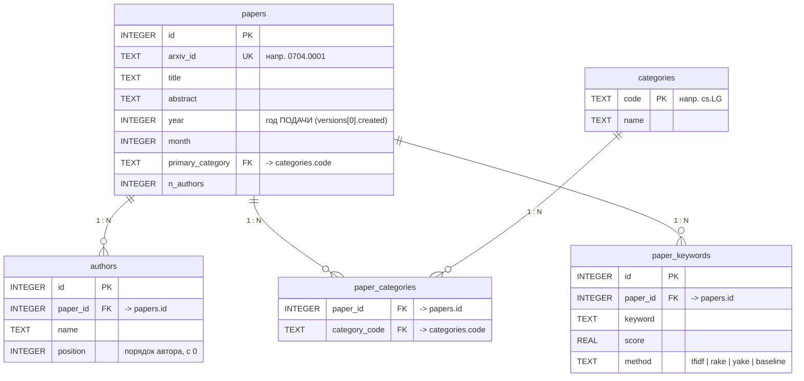

# ER-диаграмма БД `arxiv.db`

Схема: 5 таблиц, одна связь «многие ко многим» развязана промежуточной таблицей.

## Почему так

| Решение | Причина |
|---|---|
| `paper_categories` — отдельная таблица | поле `categories` в исходнике содержит несколько кодов через пробел; при хранении строкой приходится искать `LIKE '%cs.LG%'`, что ломает индекс и даёт ложные совпадения (`cs.LG` ⊂ `cs.LGx`) |
| `year` / `month` — целые числа | хранение `update_date` текстом заставляет писать `substr(...)` в `GROUP BY`, из-за чего индекс не используется |
| `paper_keywords.method` | позволяет хранить результаты нескольких экстракторов (Erlan) в одной таблице и сравнивать их между собой |
| Индексы создаются после загрузки | поддержка 6 индексов при вставке ~19 млн строк замедляет загрузку в 3–5 раз |

## Объёмы после загрузки

| Таблица | Строк |
|---|---|
| papers | см. вывод `python -m src.db.database` |
| authors | |
| paper_categories | |
| categories | |
| paper_keywords | заполняется модулем NLP (`src/nlp/`) |
